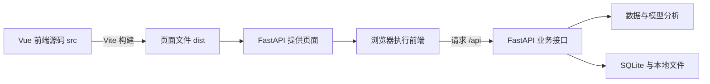

# DriftSentinel 第一版：技术栈、知识清单与学习路线

> 适用范围：当前项目第一版的用户前端、业务后端、实验分析与本地部署。本文按实际工程整理，可以边阅读代码边学习。
>
> 学习目标：能够独立启动和调试项目，解释核心实验原理，修改页面与接口，并完成一次从数据导入到监控配置导出的真实实验。

## 1. 先理解这个项目在做什么

DriftSentinel 是一个模型上线前的离线压力测试工作台，第一版面向**表格数据的二分类模型**。

完整流程：

```text
准备基准 CSV 与分类模型
  → 建立字段画像
  → 配置输入变化场景
  → 生成变化后的数据
  → 调用模型预测
  → 检测数据漂移与预测变化
  → 有有效真实标签时评估模型性能
  → 校准告警阈值
  → 保存实验，导出报告和监控配置
```

需要始终区分三个结论：

| 结论 | 需要什么信息 | 能说明什么 |
|---|---|---|
| 数据漂移 | 基准与场景的输入数据 | 输入分布发生变化 |
| 预测漂移 | 基准与场景的模型输出 | 预测类别比例或概率分布发生变化 |
| 模型性能变化 | 模型预测与有效真实标签 | F1、Recall、AUC 等指标发生变化 |

数据漂移本身不能证明模型性能下降。没有真实标签时，页面不能给出已经确认性能下降的结论。

## 2. 当前技术栈

### 2.1 前端

| 技术 | 项目中的用途 | 首先需要掌握的内容 |
|---|---|---|
| HTML | 页面结构、表单、表格 | 语义标签、输入控件、事件、可访问性基础 |
| CSS | Sonnet 风格的工作台布局、移动端适配 | 盒模型、Flex、Grid、变量、媒体查询 |
| JavaScript | 浏览器交互与异步请求基础 | 数组与对象、模块、事件、Promise、async/await |
| TypeScript | 前端业务数据类型与静态检查 | interface、联合类型、可选值、泛型、类型收窄 |
| Vue 3 | 页面与可复用组件 | 单文件组件、Composition API、ref、reactive、computed、watch |
| Vue Router | 工作台、历史、模型、数据集等页面导航 | 路由配置、RouterLink、RouterView、查询参数、Hash 路由 |
| Vite | 本地开发与生产构建 | npm 脚本、开发代理、热更新、构建产物 |
| Chart.js | 分布对照、趋势、ROC 与阈值曲线 | 数据集、坐标轴、图例、组件销毁与更新 |
| Lucide | 页面图标 | 图标组件、尺寸、可访问标签 |
| Prettier / vue-tsc | 格式统一与类型检查 | 格式化命令、理解并修复类型错误 |

前端状态使用 Vue 的响应式能力集中管理，浏览器请求使用 `fetch`。当前没有引入 Pinia、Vuex 或 Axios；先读懂现有实现，再根据复杂度决定是否需要增加工具。

### 2.2 后端与数据处理

| 技术 | 项目中的用途 | 首先需要掌握的内容 |
|---|---|---|
| Python | 业务逻辑、文件处理与实验计算 | 函数、模块、异常、路径、类型标注、虚拟环境 |
| FastAPI | 数据集、模型、实验和规则业务 API | 路由、请求体、文件上传、状态码、错误响应 |
| Pydantic | 请求参数与规则校验 | 数据模型、默认值、范围约束、跨字段校验 |
| Uvicorn | 运行 FastAPI 应用 | ASGI 基础、启动参数、端口与监听地址 |
| Pandas | CSV 读取、字段画像与样本处理 | DataFrame、列类型、缺失值、统计、分组、采样 |
| NumPy | 场景生成、随机数与模型数值运算 | 数组、形状、向量化、布尔索引、随机种子 |
| SciPy | KS 与卡方检验 | 检验统计量、p 值、检验前提、结果解释 |
| scikit-learn | 示例模型训练与分类评估 | 预处理、Pipeline、逻辑回归、预测与指标 |
| SQLite / sqlite3 | 保存数据集元信息、模型登记、实验与规则 | SQL、主键、事务、参数化查询、持久化 |
| JSON / PyYAML | 保存结构化结果与导出监控配置 | 序列化、字段约定、空值、格式有效性 |
| ThreadPoolExecutor / threading | 后台实验任务与取消信号 | 线程任务、共享状态、锁、协作式取消 |

当前后端使用 `sqlite3` 直接访问 SQLite，没有 ORM。实验使用单工作线程串行执行，前端轮询查询状态，没有引入 Redis、Celery 或消息队列。

### 2.3 测试、开发与部署

| 技术 | 项目中的用途 | 首先需要掌握的内容 |
|---|---|---|
| pytest | 算法和业务接口测试 | 断言、fixture、参数化、临时目录、测试隔离 |
| FastAPI TestClient / HTTPX | 接口请求验证 | 模拟请求、检查响应、验证错误路径 |
| Playwright | 浏览器端到端测试 | 页面定位、表单操作、等待条件、下载、移动端测试 |
| Git | 代码版本管理 | status、diff、add、commit、branch、回退与忽略文件 |
| Node.js / npm | 前端依赖与构建环境 | package.json、锁文件、npm ci、npm run |
| PowerShell / BAT | Windows 启停脚本 | 工作目录、参数、退出码、进程与错误处理 |
| Docker | 封装前后端运行环境 | 镜像、容器、多阶段构建、端口、挂载 |
| Docker Compose | 项目命名、启动、健康检查和持久化目录 | compose.yaml、up、stop、logs、restart 策略 |

版本要求与具体依赖以这些文件为准：

- [package.json](../package.json)：前端依赖、脚本和版本范围。
- [package-lock.json](../package-lock.json)：前端依赖的锁定版本。
- [requirements.txt](../requirements.txt)：Python 依赖及版本范围，目前不是完整版本锁文件。
- [Dockerfile](../Dockerfile)：容器构建与运行环境。
- [compose.yaml](../compose.yaml)：容器名称、端口、挂载和健康检查。

## 3. 前端和后端怎样配合

前端与后端是分别编写的。前端源码在 `src/`，后端源码在 `backend/`。



学习时分清这几个位置：

| 位置 | 负责的事情 |
|---|---|
| 浏览器 | 展示页面、处理点击和表单、画图、请求接口 |
| Node.js / Vite | 开发时热更新、构建前端，不负责模型实验计算 |
| Python 服务 | 读取数据、调用模型、生成场景、统计评估、保存结果 |
| SQLite 与本地目录 | 保存实验及数据，重启后仍可读取 |
| Docker 容器 | 提供运行上述应用所需的环境 |

开发时可以分别启动前端开发服务和业务服务；发布后，FastAPI 同时提供前端静态文件与 `/api` 接口，使用同一个 8000 端口。

## 4. 需要掌握的知识

### 4.1 编程与工程基础

- Python：列表、字典、函数、导入、异常、文件操作、`pathlib`、上下文管理器。
- JavaScript / TypeScript：数组操作、对象、模块、异步函数、类型与空值处理。
- 命令行：切换目录、运行程序、查看错误、识别退出码与端口冲突。
- 环境管理：Python 虚拟环境、pip、npm、依赖文件与锁文件。
- Git：小步提交、检查差异、建立分支，避免提交私有数据和模型文件。

### 4.2 Web 开发基础

- 浏览器与服务器的分工；HTTP 请求、响应、JSON 和状态码。
- GET、POST、PATCH、PUT、DELETE 在当前接口中的用途。
- 文件上传与 `multipart/form-data`。
- 表单校验、加载状态、失败反馈、空状态与重复提交处理。
- 前端路由与后端路由的区别。
- `localhost` / `127.0.0.1`、端口、开发代理与同源策略。
- 浏览器开发者工具：Console、Network、响应内容与请求耗时。

### 4.3 表格数据与统计基础

- 数值字段、类别字段、标签列；均值、方差、标准差、分位数。
- 缺失值、重复行、唯一值、异常值、类别比例与字段类型识别。
- CSV 编码、分隔符、引号、空行和格式错误。
- 分布、直方图、概率、抽样、有放回重采样。
- 随机种子与实验复现；相同输入、配置和代码版本的关系。
- 数组和 DataFrame 的复制，避免修改基准数据。

### 4.4 机器学习基础

- 训练集与测试集分离，避免在测试数据上训练或调预处理参数。
- 二分类的真实标签、预测类别与预测概率。
- 正类与负类的定义；模型输出类别必须与配置一致。
- 缺失值填补、数值标准化、类别 One-Hot 编码与未知类别处理。
- 逻辑回归的输入、权重、截距和概率输出；先理解流程，再推导细节。
- `predict` 与 `predict_proba` 的输出形状及区别。
- Accuracy、Precision、Recall、F1、ROC、AUC 与混淆矩阵。
- 类别不平衡、数据泄漏、固定模型在变化输入下的稳健性。

混淆矩阵和常用公式需要能手算小例子：

```text
Precision = TP / (TP + FP)
Recall    = TP / (TP + FN)
F1        = 2 × Precision × Recall / (Precision + Recall)
```

同时分清模型分类阈值、漂移检测阈值和“F1 下降达到实际影响”的判定标准，它们解决的是不同问题。

### 4.5 漂移检测与阈值校准

| 知识 | 在项目中需要理解到什么程度 |
|---|---|
| 数据漂移 | 输入分布变化，可能发生在单字段或多个字段 |
| 预测漂移 | 模型输出比例或概率分布变化，不直接等于预测错误增加 |
| 概念漂移 | 特征与标签关系改变；第一版的输入扰动不能直接证明它 |
| PSI | 分箱、两组占比、平滑与分数解释；阈值需要结合场景校准 |
| KS 检验 | 比较数值分布的累积分布差异；统计量与 p 值不是同一个量 |
| 卡方检验 | 比较类别计数分布；稀疏类别和样本量会影响解释 |
| p 值 | 在零假设成立的前提下，出现当前或更极端检验结果的概率；不是“模型失效概率” |
| 误报 / 漏报 | 检测结果与实际模型影响之间的关系 |
| 检测召回 / 精确率 | 有影响的场景能报出多少，报出的场景有多少实际受影响 |
| 阈值扫描 | 比较不同阈值的取舍，而不是直接套用固定标准 |

模型分类的 TP / FP / FN / TN 与阈值校准中的 TP / FP / FN / TN 处于不同层次。前者判断单条样本分类是否正确，后者判断一个场景是否被正确告警。

还需要理解当前实验的假设：均值、方差、缺失值和极端值变换保留原始标签，用于受控输入扰动分析；类别比例变化重采样完整行，保持特征与标签的配对。

### 4.6 存储、任务与部署

- SQLite 的建表、主键、事务、参数化 SQL 与 JSON 文档保存。
- 原始数据、元信息、实验配置和结果快照的区别。
- 实验状态：`queued → running → completed / failed / cancelled`。
- 前端轮询、进度更新、错误恢复与取消信号。
- Docker 镜像与运行中的容器的区别。
- 构建阶段与运行阶段；Docker 多阶段构建前端的原因。
- 端口映射、文件挂载、健康检查、容器日志和数据持久化。
- 主机路径与容器路径的区别，例如 `models/` 对应 `/app/models`。

## 5. 推荐学习顺序

不需要先把所有技术都学完。按下面顺序，每个阶段完成一个小任务，再回到项目里找到对应实现。

### 阶段 0：先运行并认识项目

**学习内容**：产品流程、目录结构、启动方式、错误日志位置。

**动手任务**：

1. 双击根目录 `start.bat`，打开示例项目并完成一次实验。
2. 查看结果、切换场景、导出 YAML，再从实验历史打开旧结果。
3. 使用 `stop.bat` 停止，再次启动，确认历史仍存在。
4. 阅读 [README.md](../README.md) 与 [PROJECT_PLAN.md](../PROJECT_PLAN.md)。

**完成标准**：能用自己的话解释“基准数据 → 场景 → 模型 → 检测 → 校准”的完整链路。

### 阶段 1：Python、命令行与 Git

**先学**：Python 基础、文件与异常、虚拟环境、pip、Git 基本操作。

**动手任务**：写一个脚本读取小文件，统计行数，处理文件不存在的情况；用 Git 保存一次修改。

**阅读代码**：[backend/storage.py](../backend/storage.py)、[requirements.txt](../requirements.txt)。

**完成标准**：能创建独立 Python 环境、安装依赖、阅读报错，并清楚本次修改了哪些文件。

### 阶段 2：Pandas、NumPy 与数据画像

**先学**：DataFrame、列类型、缺失值、统计、抽样、数组形状、随机数。

**动手任务**：读取示例 CSV，统计每列缺失率、唯一值、均值、标准差，给数值列增加 20% 的均值偏移。

**阅读代码**：[backend/analytics.py](../backend/analytics.py) 中的 `read_csv`、`profile`、`generate`。

**完成标准**：能解释每类场景修改了什么，并能证明基准数据没有被修改、相同种子结果相同。

### 阶段 3：二分类模型与指标

**先学**：训练/测试划分、预处理、逻辑回归、类别/概率输出、混淆矩阵与指标。

**动手任务**：用一个小例子手算 Precision、Recall 和 F1，再与 scikit-learn 比较；运行示例准备脚本时注意它会重新生成示例文件。

**阅读代码**：[scripts/prepare_demo.py](../scripts/prepare_demo.py)，以及 `analytics.py` 的 `load_predictor`、`validate_output`、`evaluate`。

**完成标准**：能解释为什么无标签不能算真实性能、没有概率输出时 AUC 留空，以及为什么训练集不能与基准测试集混用。

### 阶段 4：统计检测与阈值校准

**先学**：分布、分位数分箱、PSI、KS、卡方、p 值、误报与漏报。

**动手任务**：对同一字段设置多种变化强度，比较 PSI 和 F1。找出一个“漂移明显，但模型影响较小”的场景，解释原因。

**阅读代码**：`analytics.py` 中的 `distribution`、`detect`、`calibration`，以及 [tests/test_analytics.py](../tests/test_analytics.py)。

**完成标准**：能分别解释“检验显著”“漂移分数较高”“F1 达到下降标准”，并说明为什么不存在通用阈值。

### 阶段 5：HTTP、FastAPI 与 SQLite

**先学**：请求/响应、JSON、接口方法、参数校验、文件上传、SQL 基础。

**动手任务**：在 `/docs` 中调用健康检查、数据集列表与实验接口；故意提交错误参数，检查状态码和提示。

**阅读代码**：[backend/app.py](../backend/app.py)、[backend/schemas.py](../backend/schemas.py)、[backend/storage.py](../backend/storage.py)。

**完成标准**：能跟踪一次创建实验的请求，从参数校验到任务运行、结果保存与前端查询。

### 阶段 6：HTML、CSS、JavaScript 与 TypeScript

**先学**：表单与表格、Flex/Grid、媒体查询、事件、异步请求、类型。

**动手任务**：制作一个包含文件选择、字段下拉框与结果表格的小页面；用 `fetch` 请求 `/api/health` 并展示加载/失败状态。

**阅读代码**：[src/api.ts](../src/api.ts)、[src/types.ts](../src/types.ts)、[src/style.css](../src/style.css)。

**完成标准**：能够查看 Network 判断请求是否成功，理解接口数据类型，并调整一个页面的布局。

### 阶段 7：Vue 页面、路由与图表

**先学**：单文件组件、响应式状态、属性和事件、计算属性、监听、路由、图表生命周期。

**动手任务**：修改一处表单默认值、增加一个结果展示字段，并让图表随场景切换更新；检查手机宽度下的布局。

**阅读代码**：[src/main.ts](../src/main.ts)、[src/App.vue](../src/App.vue)、[src/store.ts](../src/store.ts)、[src/pages/Workbench.vue](../src/pages/Workbench.vue)、[src/components/Results.vue](../src/components/Results.vue)。

**完成标准**：能解释表单状态如何变成请求参数，任务进度如何更新，为什么切换页面时需要销毁旧图表。

### 阶段 8：测试、调试与复现

**先学**：算法测试、API 测试、浏览器测试、临时目录与测试隔离。

**动手任务**：为一个有实际意义的边界补测试，例如缺失标签、错误输出维度、全空字段或极端参数；修复问题后再运行相关测试。

**阅读代码**：[tests/test_analytics.py](../tests/test_analytics.py)、[tests/test_api.py](../tests/test_api.py)、[tests/e2e/workbench.spec.ts](../tests/e2e/workbench.spec.ts)。

**完成标准**：能说明测试验证的是哪项行为，并能区分算法问题、接口问题和页面问题。

### 阶段 9：Docker 与交付

**先学**：Dockerfile、多阶段构建、Compose、端口与挂载、健康检查、日志。

**动手任务**：修改一处页面文字后运行 `rebuild.bat`，确认修改生效；停止并重新启动，确认数据保留；查看容器日志和健康状态。

**阅读代码**：[Dockerfile](../Dockerfile)、[compose.yaml](../compose.yaml)、[scripts/start-docker.ps1](../scripts/start-docker.ps1)。

**完成标准**：能够在另一台安装了 Docker Desktop 的电脑上，按 README 启动并演示项目，解释原始文件和实验结果保存在哪里。

## 6. 时间安排建议

下面适合已经接触过一门编程语言、每天能安排约 1–2 小时的人。零基础可以增加基础阶段时间，不以周数代替完成标准。

| 时间 | 主要任务 | 应留下的成果 |
|---|---|---|
| 第 1 周 | 阶段 0–1：运行项目、Python、Git | 一次完整演示、环境笔记、首次代码提交 |
| 第 2 周 | 阶段 2：数据画像与场景生成 | 数据画像脚本、可复现的变化场景 |
| 第 3 周 | 阶段 3：二分类模型与指标 | 指标手算示例、模型输入输出说明 |
| 第 4 周 | 阶段 4：漂移检测与校准 | 不同强度实验对照、阈值解释笔记 |
| 第 5 周 | 阶段 5：FastAPI、SQLite | 一条接口的完整调用与保存流程说明 |
| 第 6 周 | 阶段 6：Web 与 TypeScript 基础 | 一个能调用真实接口的小页面 |
| 第 7 周 | 阶段 7：Vue、路由、图表 | 一项经过验证的页面功能修改 |
| 第 8 周 | 阶段 8–9：测试、Docker、交付 | 测试结果、部署记录、完整演示报告 |

如果 Python 已经熟悉，可以从阶段 2 开始；如果 Web 开发已经熟悉，重点投入阶段 2–4。无论从哪里开始，都要能够解释项目的统计与模型结论。

## 7. 常用命令与启动方式

### 7.1 日常使用

| 操作 | 文件 | 行为 |
|---|---|---|
| 使用 Docker 启动 | `start.bat` | 检查并尝试启动 Docker Desktop，启动项目并打开浏览器 |
| 停止 Docker 项目 | `stop.bat` | 停止本项目容器，保留数据；不会关闭 Docker Desktop |
| 修改代码后重建 | `rebuild.bat` | 重建镜像并自动启动，这次无需再点击 start.bat |
| 不用 Docker | `start-local.bat` | 使用本机 Python / Node.js 构建并启动；终端按 Ctrl+C 停止 |

启动后访问 `http://127.0.0.1:8000`。Docker 与本地启动默认使用同一个端口，选择一种运行。

### 7.2 开发调试

推荐在独立虚拟环境中安装 Python 依赖，下面的后端命令可直接使用项目虚拟环境的解释器。

```powershell
# 终端 1：启动可热重载的业务后端
.\.venv\Scripts\python -m uvicorn backend.app:app --reload --host 127.0.0.1 --port 8000

# 终端 2：启动前端开发服务
npm run dev
```

前端开发地址为 `http://127.0.0.1:5173`，接口文档为 `http://127.0.0.1:8000/docs`。此开发方式前先停止占用 8000 端口的 Docker 项目。

```powershell
# 后端算法与接口测试
.\.venv\Scripts\python -m pytest -q

# 类型检查与生产构建
npm run build

# 浏览器端到端测试
npm run test:e2e

# 格式化前端源码
npm run format

# 查看 Docker 项目及日志
docker compose ps
docker compose logs --tail 100
```

## 8. 学习时的优先级

| 优先级 | 内容 |
|---|---|
| 第一优先 | Python、Pandas、NumPy、二分类评估、漂移检测原理、HTTP、Git |
| 第二优先 | FastAPI、参数校验、SQLite、Vue、TypeScript、前后端联调 |
| 第三优先 | 测试设计、Docker、任务并发与取消、性能分析、工程整理 |
| 后续按需要学习 | 管理后台、账号权限、PostgreSQL、Redis、任务队列、持续监控、云部署 |

第一版无需同时学习深度学习、图像/文本模型、Kubernetes 或大模型 API。先能独立解释和维护当前真实链路，再扩展系统。

## 9. 自查问题

学完后，尝试不看代码回答这些问题：

- [ ] 一次实验中，基准数据、模型、标签、场景配置分别起什么作用？
- [ ] 为什么内置模型需要使用独立训练集和基准测试集？
- [ ] 五类场景分别怎样生成？如何避免修改原始基准数据？
- [ ] 同一随机种子为什么有助于复现？代码或模型变化后是否还保证结果相同？
- [ ] 数据漂移、预测漂移和模型性能下降有什么区别？
- [ ] PSI、KS 统计量、卡方统计量与 p 值分别说明什么？
- [ ] 为什么样本量大时，较小变化也可能得到显著 p 值？
- [ ] 无标签、单类别标签、标签值不匹配和无概率输出时，页面分别应该如何处理？
- [ ] 模型分类的误报/漏报与监控阈值校准的误报/漏报有什么区别？
- [ ] 前端在哪里运行？业务计算在哪里执行？为什么部署后只需要一个端口？
- [ ] 实验状态怎样更新？取消为什么可能需要等待当前计算步骤结束？
- [ ] 刷新页面或重启服务后，哪些数据应保留，保存在哪里？
- [ ] 为什么容器内适配器路径与 Windows 文件路径不同？
- [ ] 修改前端、后端和依赖后，各应怎样构建、验证与启动？

## 10. 官方学习资料

按当前学习阶段查阅需要的部分，不必从头读完整套文档。

| 主题 | 资料 |
|---|---|
| Python | [Python 官方教程](https://docs.python.org/zh-cn/3/tutorial/) |
| Web 基础 | [MDN Web 开发学习区](https://developer.mozilla.org/zh-CN/docs/Learn_web_development) |
| TypeScript | [TypeScript Handbook](https://www.typescriptlang.org/docs/handbook/intro.html) |
| Vue | [Vue 3 官方指南](https://cn.vuejs.org/guide/introduction.html) |
| Vue Router | [Vue Router 官方指南](https://router.vuejs.org/zh/) |
| Vite | [Vite 官方指南](https://cn.vite.dev/guide/) |
| FastAPI | [FastAPI 官方教程](https://fastapi.tiangolo.com/zh/tutorial/) |
| Pandas | [Pandas 入门教程](https://pandas.pydata.org/docs/getting_started/intro_tutorials/) |
| NumPy | [NumPy 初学者指南](https://numpy.org/doc/stable/user/absolute_beginners.html) |
| SciPy | [SciPy 统计模块](https://docs.scipy.org/doc/scipy/reference/stats.html) |
| scikit-learn | [scikit-learn 用户指南](https://scikit-learn.org/stable/user_guide.html) |
| SQLite | [SQLite SQL 文档](https://www.sqlite.org/lang.html) |
| Git | [Pro Git 中文版](https://git-scm.com/book/zh/v2) |
| pytest | [pytest 入门](https://docs.pytest.org/en/stable/getting-started.html) |
| Playwright | [Playwright 测试入门](https://playwright.dev/docs/intro) |
| Docker | [Docker 入门](https://docs.docker.com/get-started/) |
